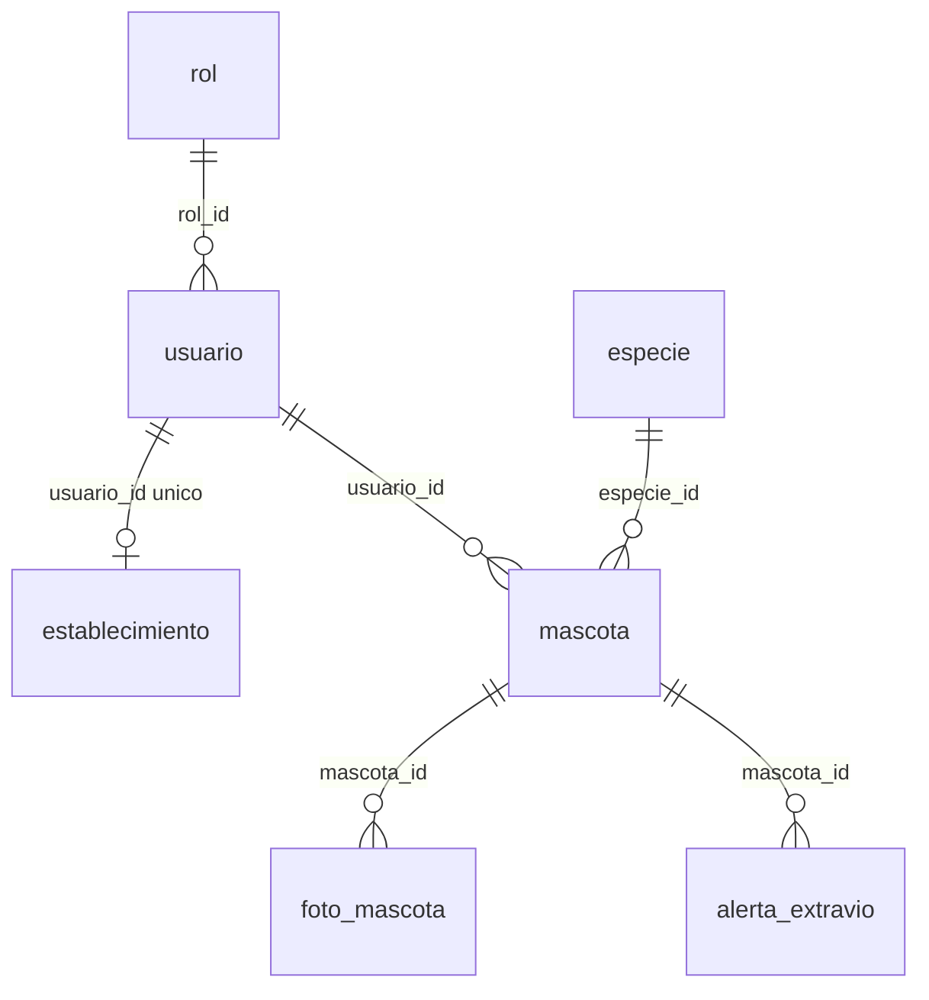

# SmartPet API

Backend de SmartPet desarrollado con **NestJS, TypeScript, PostgreSQL y TypeORM**. Implementa autenticación, roles, administración de usuarios y establecimientos, especies, mascotas propias con fotografías en Cloudinary y alertas de extravío y avistamientos.

Esta documentación describe las entidades, migraciones y controladores presentes en el repositorio. No representa una inspección de una base de datos en ejecución.

## Tecnologías

| Tecnología | Uso |
| --- | --- |
| NestJS + TypeScript | Organización de módulos, controladores y servicios de la API |
| PostgreSQL | Almacenamiento relacional |
| TypeORM | Entidades, repositorios, relaciones, transacciones y migraciones |
| JWT + Passport | Autenticación con tokens Bearer |
| bcrypt | Hash y comparación de contraseñas |
| class-validator + class-transformer | Validación y transformación de los DTO |
| Jest + Supertest | Pruebas unitarias y de integración HTTP |

## Módulos implementados

| Módulo | Responsabilidades |
| --- | --- |
| `auth` | Registrar ciudadanos o encargados, iniciar sesión, emitir JWT y consultar/actualizar el perfil propio |
| `roles` | Permitir al administrador consultar los roles disponibles |
| `usuarios` | Listar, consultar, editar y desactivar usuarios; acceso exclusivo de administrador |
| `establecimientos` | Listar, consultar, editar y desactivar veterinarias o refugios; acceso exclusivo de administrador |
| `especies` | Consultar especies disponibles para registrar mascotas |
| `mascotas` | Registrar, listar, consultar, editar y desactivar mascotas propias; agregar y eliminar fotos |
| `avistamientos` | Publicar mascotas vistas, consultar comunidad/historial propio, editar datos y fotos, cerrar o cancelar reportes propios |
| `resguardo` | Registrar y gestionar animales de veterinarias/refugios asociados a su establecimiento |
| `adopciones` | Publicar, retirar, republicar y registrar adopciones; catalogo publico institucional |
| `almacenamiento` | Servicio compartido de Cloudinary y recuperación persistente de borrados y subidas fallidas |
| `alertas-extravio` | Publicar alertas propias, consultar publicaciones activas e historial y resolver o cancelar alertas |

Los establecimientos se crean junto con el usuario mediante el registro de un encargado. No existe un endpoint independiente `POST /establecimientos`.

## Roles

El sistema utiliza tres roles, almacenados en la misma tabla `rol`:

| Rol | Función actual en la API |
| --- | --- |
| `ADMIN` | Acceder a roles y a la administración de usuarios y establecimientos; gestionar su propio perfil |
| `ENCARGADO` | Registrarse junto con su establecimiento, iniciar sesión y actualizar su perfil y los datos de su establecimiento existente |
| `CIUDADANO` | Registrarse sin establecimiento, iniciar sesión y actualizar su propio perfil |

El frontend **no envía `rol` en el registro**. El backend asigna `ENCARGADO` cuando el cuerpo incluye `establecimiento` y `CIUDADANO` cuando no lo incluye. El registro público no crea administradores.

Los tres roles pueden gestionar sus propias mascotas. En este módulo, ADMIN también está limitado a los recursos de su propiedad; no dispone de consulta global de mascotas.

## Tablas de la base de datos

Hay **once tablas de negocio** definidas en las entidades y migraciones:

| Tabla | Qué almacena |
| --- | --- |
| `rol` | Los roles disponibles |
| `usuario` | Las cuentas de todos los roles |
| `establecimiento` | Las veterinarias y los refugios/albergues de los encargados |
| `especie` | Catálogo de especies; registros iniciales Perro y Gato |
| `mascota` | Mascotas de cada usuario y sus características |
| `foto_mascota` | Referencias de fotografías alojadas en Cloudinary |
| `alerta_extravio` | Alertas actuales e históricas de extravío vinculadas a mascotas |
| `avistamiento` | Reportes de mascotas vistas con especie, referencia, fecha, punto del mapa y estado |
| `avistamiento_foto` | Fotos de cada avistamiento, principal y referencia Cloudinary |
| `animal_resguardado` | Asociacion de una mascota al establecimiento que la cuida y estado de resguardo |
| `publicacion_adopcion` | Publicacion, requisitos, disponibilidad y fecha de adopcion |

También existen las tablas técnicas `migrations` (historial de TypeORM) y `archivo_pendiente_eliminacion` (cola persistente de limpieza de archivos). Las migraciones incluyen MascotasSchema, AlertasExtravioSchema y AvistamientosSchema; la inicial se conserva.

### Tabla `rol`

Entidad: [rol.entity.ts](src/modules/roles/entities/rol.entity.ts).

| Columna SQL | Tipo | Permite NULL | Regla / significado |
| --- | --- | --- | --- |
| `id` | `integer` autoincremental (`SERIAL`) | No | Clave primaria |
| `nombre` | `varchar(30)` | No | Único; valores iniciales `ADMIN`, `CIUDADANO`, `ENCARGADO` |

Un rol puede estar asociado a muchos usuarios. Los tres nombres se definen en el enum de TypeScript `RolNombre` y se insertan mediante la migración; la columna SQL es `varchar`, no un enum de PostgreSQL.

### Tabla `usuario`

Entidad: [usuario.entity.ts](src/modules/usuarios/entities/usuario.entity.ts).

| Columna SQL | Tipo | Permite NULL | Regla / significado |
| --- | --- | --- | --- |
| `id` | `uuid` | No | Clave primaria; generado con `uuid_generate_v4()` |
| `rol_id` | `integer` | No | Clave foránea hacia `rol.id` |
| `nombre` | `varchar(100)` | No | Nombre del usuario |
| `apellido` | `varchar(100)` | No | Apellido del usuario |
| `telefono` | `varchar(20)` | Sí | Teléfono personal |
| `foto_url` | `text` | Sí | URL de la foto de perfil |
| `email` | `varchar(150)` | No | Correo único |
| `password_hash` | `varchar(255)` | No | Hash de la contraseña generado con bcrypt |
| `estado` | `boolean` | No | `true` por defecto; `false` indica una cuenta desactivada |
| `created_at` | `timestamptz` | No | Fecha de creación; valor inicial `now()` |
| `updated_at` | `timestamptz` | No | Fecha de actualización; TypeORM la actualiza al guardar mediante la entidad |

Todos los usuarios se almacenan aquí. No hay tablas separadas para administradores, ciudadanos o encargados.

La API utiliza propiedades como `rolId`, `fotoUrl`, `passwordHash`, `createdAt` y `updatedAt` en TypeScript, aunque las columnas SQL correspondientes usan nombres con guion bajo. Las respuestas de los servicios omiten el hash de contraseña.

### Tabla `establecimiento`

Entidad: [establecimiento.entity.ts](src/modules/establecimientos/entities/establecimiento.entity.ts).

| Columna SQL | Tipo | Permite NULL | Regla / significado |
| --- | --- | --- | --- |
| `id` | `uuid` | No | Clave primaria; generado con `uuid_generate_v4()` |
| `usuario_id` | `uuid` | No | Clave foránea única hacia `usuario.id` |
| `nombre` | `varchar(150)` | No | Nombre comercial o institucional |
| `tipo` | Enum `establecimiento_tipo_enum` | No | `VETERINARIA` o `REFUGIO` |
| `descripcion` | `text` | Sí | Descripción del establecimiento |
| `direccion` | `varchar(255)` | No | Dirección escrita |
| `latitud` | `numeric(10,8)` | Sí | Latitud de la ubicación |
| `longitud` | `numeric(11,8)` | Sí | Longitud de la ubicación |
| `telefono` | `varchar(20)` | No | Teléfono del establecimiento |
| `horario_atencion` | `varchar(150)` | Sí | Horario de atención |
| `estado` | `boolean` | No | `true` por defecto; `false` indica un establecimiento desactivado |
| `created_at` | `timestamptz` | No | Fecha de creación; valor inicial `now()` |
| `updated_at` | `timestamptz` | No | Fecha de actualización gestionada por TypeORM al guardar |

Veterinarias y refugios comparten esta tabla y se distinguen por `tipo`. La unicidad de `usuario_id` permite como máximo un establecimiento por usuario. Las propiedades TypeScript correspondientes incluyen `usuarioId` y `horarioAtencion`.

La API admite coordenadas opcionales; los DTO validan latitud entre -90 y 90 y longitud entre -180 y 180. Estos rangos se validan en la aplicación, no mediante restricciones `CHECK` en la migración inicial. El mapa del frontend selecciona el punto y envía las coordenadas internamente.

### Tabla `especie`

| Columna SQL | Tipo | Regla |
| --- | --- | --- |
| `id` | `SERIAL` | Clave primaria |
| `nombre` | `varchar(100)` | Obligatorio y único |

Las semillas iniciales son `Perro` y `Gato`. No existe tabla `raza`.

### Tabla `mascota`

| Columna SQL | Tipo | Regla |
| --- | --- | --- |
| `id` | `uuid` | Clave primaria generada |
| `usuario_id` | `uuid` | Obligatorio; FK a `usuario.id`; tomado del JWT |
| `especie_id` | `integer` | Obligatorio; FK a `especie.id` |
| `raza_nombre` | `varchar(100)` | Opcional; texto libre |
| `nombre` | `varchar(100)` | Obligatorio y no vacío |
| `sexo` | `varchar(15)` | Opcional; MACHO, HEMBRA o DESCONOCIDO |
| `color` | `varchar(100)` | Opcional |
| `peso_kg` | `numeric(6,2)` | Opcional; positivo |
| `edad_aproximada_meses` | `integer` | Opcional; no negativo |
| `estado` | `boolean` | Obligatorio, `true` por defecto; baja lógica |
| `created_at` | `timestamptz` | Obligatorio, `now()` por defecto |
| `updated_at` | `timestamptz` | Obligatorio, gestionado por TypeORM al guardar |

No incluye `raza_id` ni `distintivos`. `estado` no representa extravío. Las claves foráneas impiden borrar físicamente usuarios o especies que tengan mascotas. Existe un índice para listar mascotas por propietario y estado.

### Tabla `foto_mascota`

| Columna SQL | Tipo | Regla |
| --- | --- | --- |
| `id` | `uuid` | Clave primaria generada |
| `mascota_id` | `uuid` | Obligatorio; FK a `mascota.id` con borrado físico en cascada |
| `url` | `text` | Obligatorio; URL HTTPS devuelta por Cloudinary |
| `storage_key` | `varchar(500)` | Obligatorio y único; public_id de Cloudinary |
| `proveedor` | `varchar(20)` | Obligatorio; CLOUDINARY |
| `es_principal` | `boolean` | Obligatorio, `false` por defecto |
| `created_at` | `timestamptz` | Obligatorio, `now()` por defecto |

La base guarda referencias, no imágenes binarias. Un índice parcial único impide más de una principal por mascota. El servicio mantiene entre una y cinco fotos; serializa las modificaciones con bloqueo de la mascota. La primera foto es principal y, al eliminarla, se promueve la restante más antigua. La baja lógica conserva sus fotografías.

### Tabla técnica `archivo_pendiente_eliminacion`

Columnas: `id` UUID generado, `storage_key` varchar(500) único y `disponible_desde` timestamptz; todas obligatorias. Permite recuperar subidas fallidas y reintentar borrados remotos después de reiniciar la API. No almacena credenciales ni archivos. Consulta el comportamiento de fallos parciales en [docs/mascotas.md](docs/mascotas.md#fallos-parciales-y-limpieza).

### Tabla `alerta_extravio`

| Columna SQL | Tipo | Regla |
| --- | --- | --- |
| `id` | `uuid` | PK generada |
| `mascota_id` | `uuid` | Obligatoria; FK a mascota.id con ON DELETE RESTRICT |
| `descripcion` | `text` | Opcional; DTO limita a 2000 caracteres |
| `fecha_extravio` | `timestamptz` | Obligatoria; API rechaza fechas futuras |
| `latitud` | `numeric(10,8)` | Obligatoria; -90 a 90 |
| `longitud` | `numeric(11,8)` | Obligatoria; -180 a 180 |
| `estado` | `varchar(20)` | ACTIVA por defecto; también RESUELTA, CANCELADA, OCULTA |
| `fecha_resolucion` | `timestamptz` | Nullable; servidor la asigna al resolver |
| `created_at` | `timestamptz` | Obligatoria; now() por defecto |
| `updated_at` | `timestamptz` | Obligatoria; TypeORM la actualiza al guardar |

La migración `1794862800000-AlertasExtravioSchema.ts` agrega esta tabla sin modificar migraciones previas. Un índice único parcial impide dos ACTIVA para una mascota; el historial permite varias alertas cerradas. No guarda usuario_id, radio_km ni fotos. El propietario viene de la mascota y la imagen pública es su principal actual. No utiliza PostGIS.

Los tres roles publican y gestionan solo alertas de sus mascotas. El listado público muestra únicamente ACTIVA con mascota activa y omite datos privados del propietario. Mis alertas conserva el historial. Solo ACTIVA admite edición, resolución o cancelación; los estados terminales no se reabren. OCULTA queda reservado para futura moderación.

### Relaciones



- Cada usuario tiene un rol; un rol puede tener varios usuarios.
- Cada establecimiento pertenece a un usuario; un usuario puede no tener establecimiento o tener uno.
- La migración impide eliminar físicamente un rol que tenga usuarios (`ON DELETE RESTRICT`).
- La migración elimina el establecimiento si se elimina físicamente su usuario (`ON DELETE CASCADE`). Los endpoints de baja actuales solo cambian `estado` a `false`, por lo que no ejecutan esta cascada.
- La desactivación por API de un usuario y la de su establecimiento son operaciones independientes: los servicios actuales no propagan automáticamente el cambio de `estado` entre ambos.

## Endpoints disponibles

Prefijo global: `/api/v1`. URL local por defecto: `http://localhost:3000/api/v1`.

| Método | Ruta sin prefijo | Acceso | Operación |
| --- | --- | --- | --- |
| `POST` | `/auth/register` | Público | Registrar ciudadano o encargado con establecimiento |
| `POST` | `/auth/login` | Público | Iniciar sesión y obtener `access_token` y `usuario` |
| `GET` | `/auth/profile` | Usuario autenticado | Obtener el perfil propio |
| `PATCH` | `/auth/profile` | Usuario autenticado | Actualizar datos propios y el establecimiento asociado si existe |
| `GET` | `/roles` | `ADMIN` | Listar roles |
| `GET` | `/usuarios` | `ADMIN` | Listar usuarios |
| `GET` | `/usuarios/:id` | `ADMIN` | Consultar usuario por UUID |
| `PATCH` | `/usuarios/:id` | `ADMIN` | Actualizar usuario |
| `DELETE` | `/usuarios/:id` | `ADMIN` | Desactivar usuario |
| `GET` | `/establecimientos` | `ADMIN` | Listar establecimientos |
| `GET` | `/establecimientos/:id` | `ADMIN` | Consultar establecimiento por UUID |
| `PATCH` | `/establecimientos/:id` | `ADMIN` | Actualizar establecimiento |
| `DELETE` | `/establecimientos/:id` | `ADMIN` | Desactivar establecimiento |
| `GET` | `/especies` | Autenticado | Listar especies |
| `POST` | `/mascotas` | Los tres roles | Registrar mascota propia y 1–5 fotos mediante multipart |
| `GET` | `/mascotas/mis-mascotas` | Los tres roles | Listar mascotas propias activas |
| `GET` | `/mascotas/:id` | Propietario | Consultar mascota activa |
| `PATCH` | `/mascotas/:id` | Propietario | Actualizar datos sin fotografías |
| `DELETE` | `/mascotas/:id` | Propietario | Desactivar mascota sin borrar sus fotos |
| `POST` | `/mascotas/:id/fotos` | Propietario | Agregar fotos sin superar cinco en total |
| `DELETE` | `/mascotas/:id/fotos/:fotoId` | Propietario | Eliminar una foto y gestionar su limpieza remota |
| `POST` | `/alertas-extravio` | Propietario, tres roles | Publicar alerta de mascota propia activa |
| `GET` | `/alertas-extravio` | Público | Listar ACTIVA con mascota activa |
| `GET` | `/alertas-extravio/mis-alertas` | Autenticado | Listar alertas propias, incluyendo historial |
| `GET` | `/alertas-extravio/:id` | Público / propietario | Detalle público activo o historial con JWT del dueño |
| `PATCH` | `/alertas-extravio/:id` | Propietario | Editar descripción, fecha y ubicación de alerta activa |
| `PATCH` | `/alertas-extravio/:id/resolver` | Propietario | Resolver alerta y registrar fecha de resolución |
| `PATCH` | `/alertas-extravio/:id/cancelar` | Propietario | Cancelar alerta sin borrar historial |

Las listas de usuarios y establecimientos admiten `limit` y `offset`, con valores predeterminados de 10 y 0. Devuelven arreglos e incluyen registros desactivados; no devuelven un objeto de paginación con el total.

Para rutas privadas se utiliza `Authorization: Bearer <access_token>`. Consulta los cuerpos de las peticiones en [docs/README.md](docs/README.md) o importa la [colección de Postman](docs/smartpet_api.postman_collection.json).

La guía [Mascotas: HTTP y Postman](docs/mascotas.md) explica cada endpoint, campos form-data/JSON, fotos permitidas, foto principal, fallos parciales y pruebas.

La guía [Alertas de extravío: HTTP y Postman](docs/alertas-extravio.md) incluye los siete endpoints, reglas de visibilidad, estados, concurrencia y ejemplos JSON. Los listados de alertas usan limit/offset y devuelven arreglos.

## Autenticación y validación

- Contraseñas almacenadas como hashes bcrypt con factor de trabajo 10.
- JWT con identificador de usuario (`sub`), email y rol, además de los campos temporales del token.
- La estrategia JWT comprueba en la base de datos que el usuario siga activo y obtiene su rol actual.
- `JWT_SECRET` es obligatorio: si falta o está vacío, la configuración lanza un error al iniciar.
- `JWT_EXPIRES_IN` usa `1d` por defecto.
- Los DTO validan las entradas. El `ValidationPipe` global rechaza campos adicionales mediante `forbidNonWhitelisted`; por ejemplo, enviar `rol` al registro produce un error 400.
- El registro de usuario y establecimiento se realiza en una transacción. La actualización del perfil y su establecimiento también utiliza una transacción.
- Los errores de base de datos se manejan mediante un filtro global en `src/common/filters/database-exception.filter.ts`.

## Estructura del backend

```text
smartpet_api/
  src/
    main.ts                   # Arranque, CORS, prefijo y validación global
    app.module.ts             # Configuración e integración de módulos
    config/                   # Configuración de PostgreSQL y JWT
    common/
      dtos/                   # DTO de paginación
      filters/                # Manejo global de errores de base de datos
    migrations/               # Cambios versionados del esquema
    modules/
      auth/                   # Registro, login, perfil, JWT y permisos
      roles/                  # Entidad y consulta de roles
      usuarios/               # Entidad y administración de usuarios
      establecimientos/       # Entidad y administración de establecimientos
      especies/               # Catálogo de especies
      mascotas/               # Mascotas propias, DTO y fotografías
      almacenamiento/         # Cloudinary y limpieza persistente de archivos
      alertas-extravio/        # Publicaciones, historial y cierre de alertas
  test/                       # Pruebas e2e y soporte de pruebas
  specs/                      # Especificaciones, diseños y tareas
  docs/                       # Documentación HTTP y colección Postman
  .env.example                # Variables de entorno documentadas
```

## Configuración y ejecución local

1. Instala las dependencias desde `smartpet_api`:

   ```bash
   npm install
   ```

2. Copia `.env.example` a `.env` y configura las variables según tu entorno. No publiques `.env` ni credenciales reales.

   | Variable | Propósito |
   | --- | --- |
   | `PORT` | Puerto HTTP; por defecto 3000 |
   | `CORS_ORIGINS` | Orígenes permitidos, separados por comas; por defecto `http://localhost:5173` |
   | `DB_HOST` | Host de PostgreSQL |
   | `DB_PORT` | Puerto de PostgreSQL |
   | `DB_USER` | Usuario de PostgreSQL |
   | `DB_PASSWORD` | Contraseña de PostgreSQL |
   | `DB_NAME` | Base de datos que utilizará SmartPet |
   | `JWT_SECRET` | Secreto obligatorio para firmar y verificar JWT |
   | `JWT_EXPIRES_IN` | Duración del token; por defecto `1d` |
   | `CLOUDINARY_CLOUD_NAME` | Nombre del entorno Cloudinary |
   | `CLOUDINARY_API_KEY` | API key privada para peticiones del backend |
   | `CLOUDINARY_API_SECRET` | Secreto privado para firmar subidas y borrados |

3. Crea en PostgreSQL la base indicada en `DB_NAME` y ejecuta las migraciones:

   ```bash
   npm run migration:run
   ```

   La migración inicial crea las tres tablas, el enum de establecimientos, los tres roles y un usuario administrador inicial. También requiere crear o disponer de la extensión PostgreSQL `uuid-ossp`. Actualmente la migración contiene una contraseña inicial fija para ese administrador; cámbiala antes de desplegar. No se reproducen credenciales en este documento.

4. Inicia el servidor:

   ```bash
   npm run start:dev
   ```

El esquema se administra con migraciones: `synchronize` está desactivado. El arranque normal no ejecuta las migraciones automáticamente.

Al ejecutar `migration:run` también se aplica la migración de mascotas si está pendiente. Cloudinary se configura únicamente en el backend: `CLOUDINARY_CLOUD_NAME`, `CLOUDINARY_API_KEY` y `CLOUDINARY_API_SECRET` son obligatorias y se validan al iniciar en `src/config/cloudinary.config.ts`. Si falta alguna o está vacía, el backend no inicia e indica su nombre sin mostrar el valor. Esta validación local no comprueba las credenciales contra Cloudinary. Se utiliza su API REST firmada con funciones nativas de Node.js; no se agregan dependencias.

Para ejecutar las pruebas e2e contra PostgreSQL en un esquema temporal aislado, establece `SMARTPET_TEST_DATABASE=1` y ejecuta `npm run test:e2e -- --runInBand`. Las pruebas usan Cloudinary simulado y eliminan su esquema al terminar; sin esa variable se omiten explícitamente.

## Comandos del proyecto

| Comando | Función |
| --- | --- |
| `npm run start:dev` | Desarrollo con recarga |
| `npm run build` | Compilar el backend |
| `npm run start:prod` | Ejecutar el código compilado |
| `npm run lint` | Revisar y corregir formato/reglas con ESLint |
| `npm test` | Ejecutar pruebas unitarias |
| `npm run test:e2e` | Ejecutar pruebas e2e |
| `npm run test:cov` | Obtener cobertura de pruebas |
| `npm run migration:generate -- src/migrations/NombreDelCambio` | Generar una migración a partir de diferencias entre entidades y base de datos |
| `npm run migration:run` | Aplicar migraciones pendientes |
| `npm run migration:revert` | Revertir la última migración; la reversión inicial elimina tablas y sus datos |

## Alcance pendiente

El backend todavía no define entidades, tablas ni endpoints para reportes adicionales, notificaciones, actividades o estadísticas del dashboard. Tampoco incluye búsquedas por distancia, PostGIS, IA, embeddings ni reconocimiento CNN. Las mascotas propias, sus fotografías y las alertas de extravío ya están implementadas; los clientes pueden consumir los endpoints documentados.

Los mapas vectoriales de MapLibre y OpenFreeMap se configuran en el frontend. Este backend almacena la dirección y las coordenadas del establecimiento, pero no sirve mapas ni mosaicos.


## Avistamientos

Dos tablas nuevas mediante `1794945600000-AvistamientosSchema.ts`: `avistamiento` y `avistamiento_foto`. Un usuario tiene muchos reportes; una especie tiene muchos avistamientos; un reporte tiene de una a cinco fotos. No exige mascota ni alerta identificada. El reporte guarda descripcion, direccion, fecha_avistamiento, latitud, longitud y estado (ACTIVO, CERRADO, CANCELADO), ademas de propietario y fechas. Las fotos guardan URL, storage_key unico, proveedor, es_principal y fecha. Las respuestas publicas omiten propietario y claves de almacenamiento.

Nueve endpoints nuevos bajo `/api/v1/avistamientos`, descritos en [contrato de avistamientos](specs/avistamientos/design.md) y [documentacion HTTP](docs/README.md). Los reportes activos son publicos; el historial y las modificaciones requieren JWT del autor. No hay privilegio global de ADMIN en este modulo. Solo ACTIVO permite editar/fotos/cerrar/cancelar. Cerrar no confirma identidad ni rescate. IA y coincidencias permanecen pendientes.


## Resguardo institucional y adopciones

Los encargados de veterinarias/refugios activos registran animales bajo `/api/v1/animales-resguardados`. Se reutiliza la ficha de mascota con sus fotos y se crea una asociacion institucional atomica. Las mascotas personales previas no se convierten automaticamente. Publicar para adopcion es un paso independiente mediante `/api/v1/adopciones`.

Estados de resguardo: EN_RESGUARDO y ADOPTADO. Publicaciones: PUBLICADA, RETIRADA y ADOPTADA. Retirar permite republicar; marcar adoptado es terminal y deja la ficha de solo lectura. Catalogo publico con contacto institucional; gestion exclusiva de su ENCARGADO. Sin solicitudes, adoptantes, chat ni IA. [Documentacion HTTP](docs/resguardo-adopciones.md).

Migracion `1794952800000-ResguardoAdopcionesSchema.ts`: crea dos tablas e indices, sin modificar tablas previas. No requiere variables ni paquetes nuevos. Rutas web: `/pets` (resguardo), `/adoptions` (gestion) y `/adopciones` (catalogo publico).
