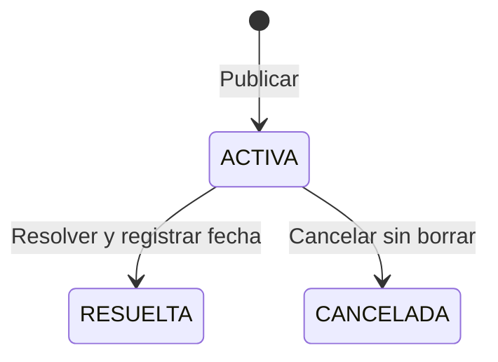

# Alertas de extravío: HTTP y Postman

Base URL: `http://localhost:3000/api/v1`. Este módulo publica alertas vinculadas a mascotas existentes. No duplica propietarios ni fotografías. La tabla es `alerta_extravio`; las propiedades JSON usan **camelCase**, como los demás módulos (`mascotaId`, `fechaExtravio`, `fechaResolucion`).

## Preparación y migración

Desde `smartpet_api`:

```bash
npm run migration:run
npm run start:dev
```

La migración nueva `src/migrations/1794862800000-AlertasExtravioSchema.ts` crea la tabla, FK, checks, índices de consulta e índice único parcial para una alerta ACTIVA por mascota. Las migraciones anteriores se conservan; `synchronize` sigue desactivado. Usa las variables de PostgreSQL, JWT y Cloudinary ya requeridas por la aplicación; este módulo no agrega variables ni dependencias.

Importa [smartpet_api.postman_collection.json](smartpet_api.postman_collection.json). Ejecuta Login para guardar `access_token`, registra una mascota con el módulo anterior o asigna un UUID propio a `mascota_id`, y abre la carpeta **Alertas de extravío**. El POST guarda `alerta_id` para las peticiones siguientes. Las operaciones privadas requieren `Authorization: Bearer {{access_token}}` para ADMIN, CIUDADANO o ENCARGADO. ADMIN también debe ser propietario.

## 1. Publicar alerta

`POST {{baseUrl}}/alertas-extravio` — autenticado, Body → raw → JSON:

```json
{
  "mascotaId": "{{mascota_id}}",
  "descripcion": "Se perdió cerca de la plaza. Lleva collar azul.",
  "fechaExtravio": "2020-01-01T12:00:00-04:00",
  "latitud": -17.7833,
  "longitud": -63.1821
}
```

Sustituye fecha y ubicación por las reales. `descripcion` es opcional, admite null y tiene un máximo de 2000 caracteres. La fecha debe ser ISO 8601 válida, incluir hora y zona (`Z` o `±HH:mm`) y no ser futura. Las coordenadas son números JSON, con hasta ocho decimales y rangos [-90,90] / [-180,180]. Son datos internos enviados por la selección del mapa del cliente, no campos de coordenadas para el usuario final.

La mascota debe estar activa y pertenecer al JWT. El backend asigna ACTIVA y fechaResolucion=null. No envíes `estado`, `usuarioId`, `usuario_id`, `fechaResolucion`, campos de auditoría, fotos ni `radio_km`.

Respuesta: **201**. Mascota ajena, inexistente o desactivada: 404. Otra alerta ACTIVA de la misma mascota: 409. La regla se comprueba con bloqueo transaccional y también con un índice único parcial en PostgreSQL.

## 2. Listar alertas públicas

`GET {{baseUrl}}/alertas-extravio?limit=10&offset=0` — Authorization → **No Auth**, sin body.

Respuesta **200**, arreglo que contiene solo alertas ACTIVA de mascotas activas. Valores predeterminados de paginación: limit=10, offset=0. Orden: createdAt descendente e id ascendente. No devuelve total.

Incluye los datos de la alerta y un objeto `mascota` con id, nombre, especie, razaNombre, sexo, color, edadAproximadaMeses, estado y `fotoPrincipal: { id, url }` o null. No incluye datos privados del dueño, usuarioId, teléfonos, correo, hashes ni claves de almacenamiento. Solo se usa la fotografía principal actual de la mascota; no se copian archivos ni fotos secundarias.

## 3. Listar mis alertas

`GET {{baseUrl}}/alertas-extravio/mis-alertas?limit=10&offset=0` — Bearer Token, sin body.

Respuesta **200**, arreglo exclusivo del propietario autenticado. Incluye ACTIVA, RESUELTA, CANCELADA y OCULTA, y conserva acceso al historial aunque la mascota esté desactivada. Usa la misma paginación y orden que el listado público. La ruta estática `mis-alertas` se declara antes de `:id`.

## 4. Consultar detalle

`GET {{baseUrl}}/alertas-extravio/{{alerta_id}}` — sin body.

- Con **No Auth**: permite únicamente ACTIVA con mascota activa; fuera de esa visibilidad responde 404.
- Con Bearer Token válido: el propietario también puede consultar su historial. Otro usuario o ADMIN ajeno no puede acceder al historial privado.
- Un token enviado pero inválido, expirado o de usuario inactivo responde 401; para consultar públicamente, omite Authorization.

Respuesta **200** con los mismos campos públicos que el listado. Las coordenadas se devuelven como números, aunque PostgreSQL almacene columnas numeric. Un UUID mal formado responde 400.

## 5. Actualizar alerta activa

`PATCH {{baseUrl}}/alertas-extravio/{{alerta_id}}` — Bearer Token, Body → raw → JSON:

```json
{
  "descripcion": "Última vez vista junto al parque.",
  "fechaExtravio": "2020-01-01T13:30:00-04:00",
  "latitud": -17.784,
  "longitud": -63.183
}
```

Todos los campos son opcionales en PATCH; omitirlos conserva su valor. Solo descripcion admite null. No permite cambiar mascotaId, estado, fechaResolucion ni auditoría. Responde **200**. Recurso ajeno/inexistente: 404. Estado distinto de ACTIVA: 409. La mascota puede estar desactivada: el dueño conserva la capacidad de editar o cerrar su alerta activa, aunque ya no sea pública.

## 6. Resolver alerta

`PATCH {{baseUrl}}/alertas-extravio/{{alerta_id}}/resolver` — Bearer Token, sin body o JSON `{}`.

Solo propietario y estado ACTIVA. Cambia a RESUELTA y asigna fechaResolucion con la hora del servidor. Responde **200** con la alerta actualizada. No acepta estado ni fecha enviados por el cliente. Una alerta resuelta permanece en el historial y deja de verse públicamente. Repetir o intentar resolver un estado terminal responde 409.

## 7. Cancelar alerta

`PATCH {{baseUrl}}/alertas-extravio/{{alerta_id}}/cancelar` — Bearer Token, sin body o JSON `{}`.

Solo propietario y estado ACTIVA. Cambia a CANCELADA sin borrar la fila; fechaResolucion queda null porque cancelar no significa recuperar la mascota. Responde **200**. No se puede cancelar una alerta ya resuelta, cancelada u oculta (409).

## Estados y concurrencia



OCULTA queda reservado para futura moderación y no tiene endpoint en este módulo. No hay reapertura ni edición de estados terminales. Al cerrar una alerta puede crearse otra para la misma mascota, conservando el historial.

Crear y modificar bloquean primero la mascota y después la alerta, manteniendo el mismo orden que las operaciones de mascotas. Dos POST simultáneos para la misma mascota producen una creación y un conflicto. Resolver y cancelar simultáneamente producen un único cierre y un conflicto; se vuelve a comprobar el estado dentro de la transacción.

## Archivos creados y modificados

| Archivo / carpeta | Cambio |
| --- | --- |
| `src/modules/alertas-extravio/` | Controller, service, module y pruebas del servicio |
| `src/modules/alertas-extravio/entities/alerta-extravio.entity.ts` | Entidad vinculada a Mascota, sin propietario duplicado |
| `src/modules/alertas-extravio/enums/estado-alerta.enum.ts` | Cuatro estados del requerimiento |
| `src/modules/alertas-extravio/dto/` | Create, Update, body vacío para cierres, validador de fecha y pruebas |
| `src/modules/alertas-extravio/guards/optional-jwt.guard.ts` | Reutiliza la estrategia JWT existente para detalle público/propio |
| `src/migrations/1794862800000-AlertasExtravioSchema.ts` | Migración adicional y reversión |
| `src/app.module.ts` | Registro del nuevo módulo |
| `test/alertas-extravio.e2e-spec.ts` | Pruebas HTTP con JWT y PostgreSQL real aislado |
| `test/app.e2e-spec.ts` | Fixture de regresión incluye la nueva entidad/migración y UUID de prueba RFC 4122 |
| `specs/alertas-extravio/` | Especificación, diseño y tareas |
| `README_BACKEND.md`, `docs/README.md`, esta guía y colección Postman | Alcance, tablas y peticiones actualizados |

Los métodos públicos del service siguen el orden del controller; los auxiliares quedan al final. No se modifican los contratos de autenticación, usuarios, establecimientos ni mascotas.

## Pruebas

```bash
npm run build
npm test -- --runInBand
npm run lint
```

Pruebas e2e opt-in con PostgreSQL accesible en la configuración existente y permisos para crear un esquema y función temporales:

```powershell
$env:SMARTPET_TEST_DATABASE='1'
npm run test:e2e -- --runInBand
```

Se crean esquemas `smartpet_test_<uuid>` y se eliminan al terminar. Las migraciones se aplican y revierten únicamente allí, sin tocar datos habituales ni usar una cuenta Cloudinary real. Sin SMARTPET_TEST_DATABASE=1 las suites PostgreSQL se omiten explícitamente.

La cobertura incluye JWT, tres roles, recursos ajenos, mascota inactiva, privacidad pública, principal, historial, validación, DTO adicionales, transiciones, concurrencia, restricción parcial de PostgreSQL, paginación y reversión de la migración.

No se implementan radio persistente, PostGIS, búsquedas por distancia, avistamientos, IA, notificaciones ni moderación.
