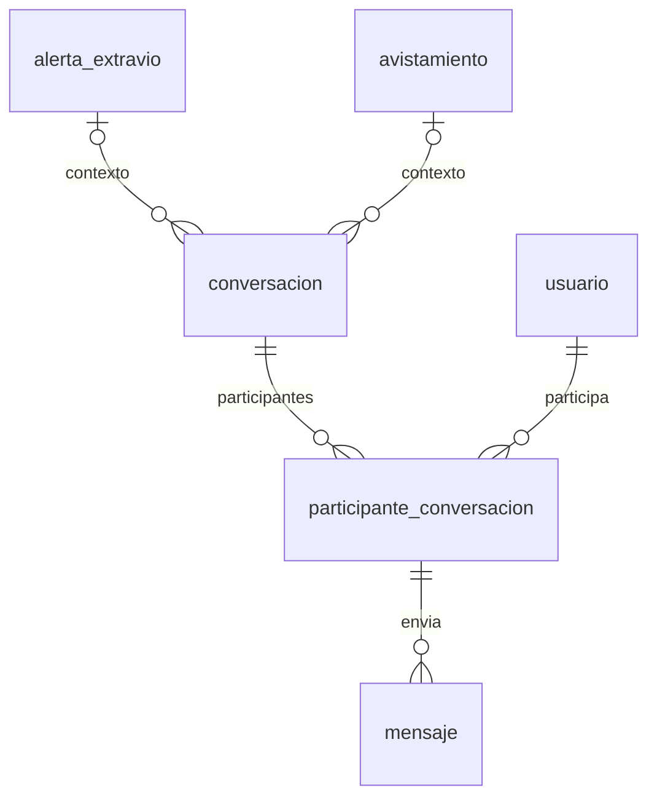

# Diseño del módulo chat

conversacion: id uuid PK, alerta_id uuid nullable FK alerta_extravio RESTRICT, avistamiento_id uuid nullable FK avistamiento RESTRICT, created_at timestamptz. CHECK exactamente una referencia no nula; índices parciales de alerta/avistamiento.

participante_conversacion: id uuid PK, conversacion_id uuid FK CASCADE, usuario_id uuid FK usuario RESTRICT, ultima_lectura_at timestamptz nullable, created_at timestamptz. UNIQUE(conversacion_id,usuario_id), índice(usuario_id,conversacion_id) para bandeja. No hay FK circular al último mensaje.

mensaje: id uuid PK, participante_id uuid FK participante_conversacion CASCADE, contenido text, created_at timestamptz. CHECK contenido no blanco (incluye espacios, tabulaciones y saltos) y hasta 4000 caracteres. Índice(participante_id,created_at,id); el historial se consulta uniendo los dos participantes de la conversación y ordenando created_at,id con paginación.

Relaciones unidireccionales a las entidades existentes para no alterar módulos de usuarios/alertas/avistamientos. Relaciones inversas dentro de chat. ChatModule usa TypeOrmModule.forFeature y se registra en AppModule. Migración ChatSchema1794960000000; reversión en orden mensaje, participante_conversacion, conversacion. Sin dependencias ni env nuevos.

## Próxima etapa de servicios

Abrir chat: bloquear la publicación en transacción, obtener su propietario (alerta → mascota.usuarioId; avistamiento → usuarioId), validar ambos usuarios y buscar conversación que contenga exactamente la pareja antes de crear otra y sus dos participantes. La serialización sobre la publicación evita duplicados concurrentes. Enviar/leer: identificar participante desde JWT y verificar pertenencia; nunca devolver entidades Usuario sin selección explícita de campos públicos. Los eventos en tiempo real requerirán el mismo control.

